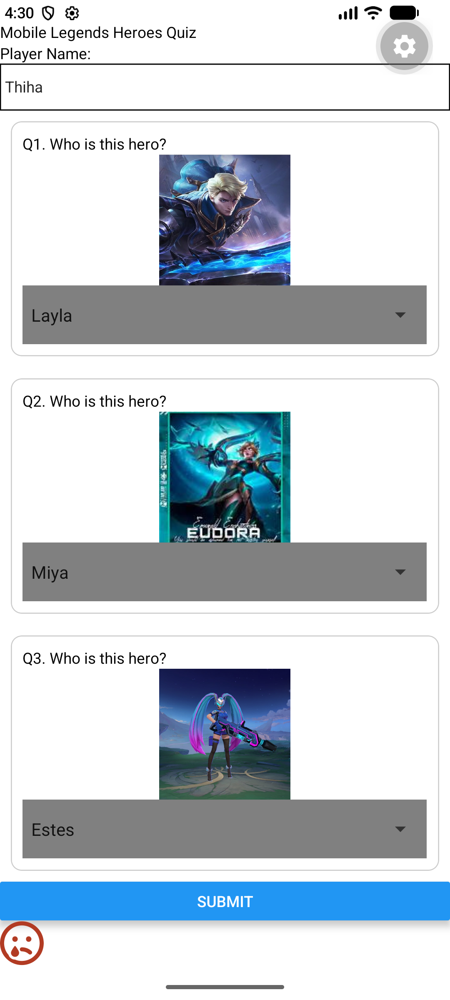
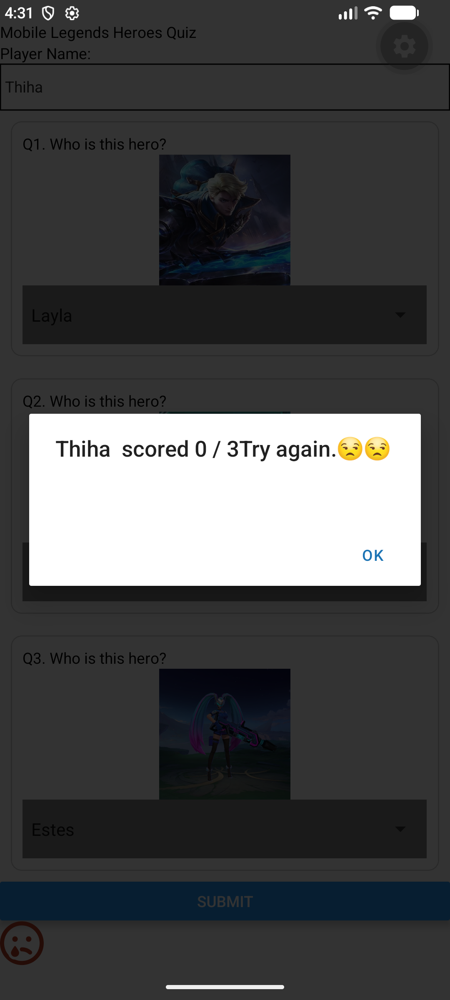
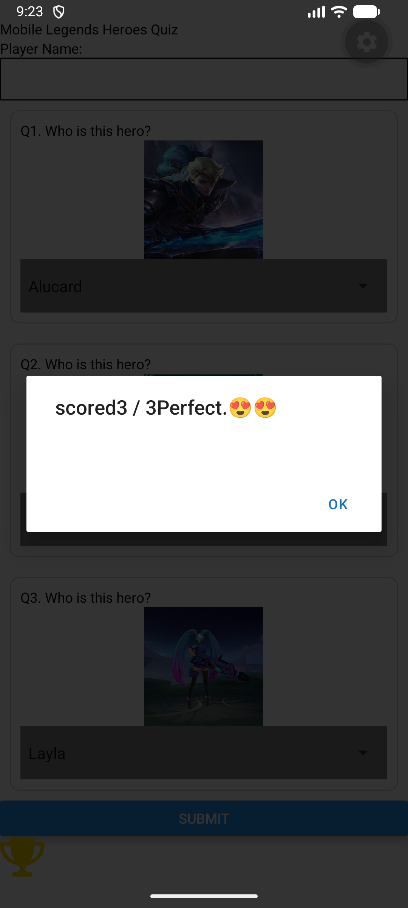
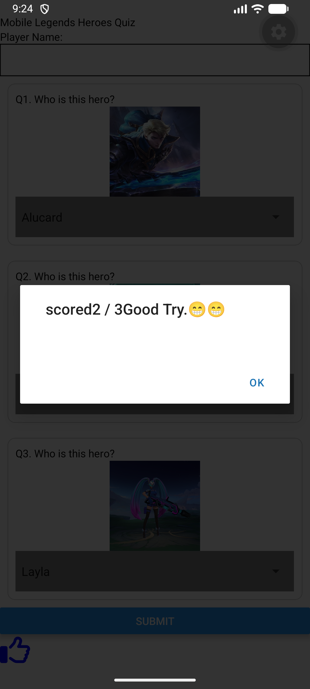
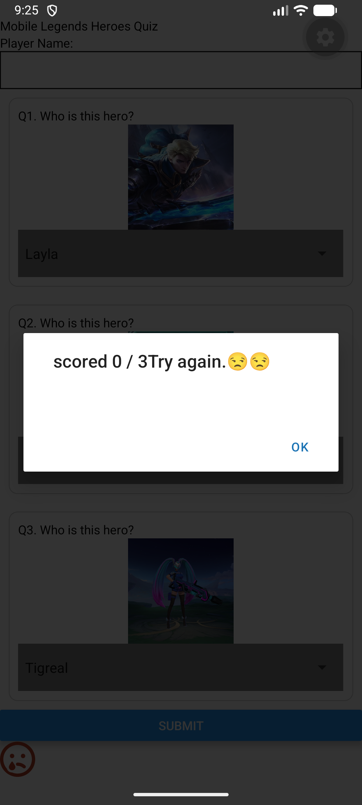
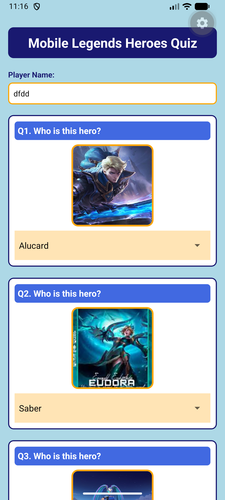
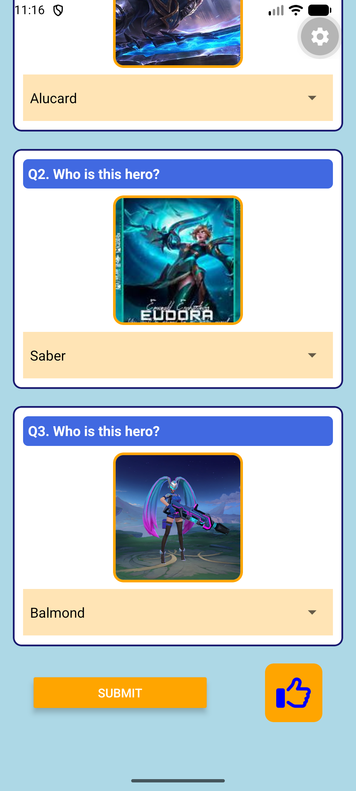

# Mobile Legends Heroes Quiz

A mobile quiz app built with React Native and Expo. The player enters their name, looks at a picture of three Mobile Legends heroes and picks each hero's name from a dropdown. After pressing SUBMIT, the app shows the score and an icon (trophy, thumbs up or sad face) depending on how many answers are correct.

In Lesson 08 the app was styled using StyleSheet and Flexbox: a coloured title bar and background, bordered input box, question cards with coloured headers, framed hero images, coloured dropdowns, and the SUBMIT button and result icon placed side by side in a row.

## ScreenShots of App BEFORE applying Stylesheet changes

Screenshots:

## ScreenShots of App AFTER applying Stylesheet changes

Screenshots:

## Link to Demo Video with audible narration explaining styling changes with code reference

Demo Video Link: [Watch the demo video](https://myrp-my.sharepoint.com/:v:/g/personal/25036723_myrp_edu_sg/IQBedQVKF9HsQb-WSjlNXuvgAWczI2SvLnse3CjmAsVjzvQ?e=Drxyqc)
